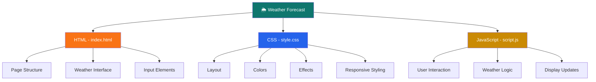
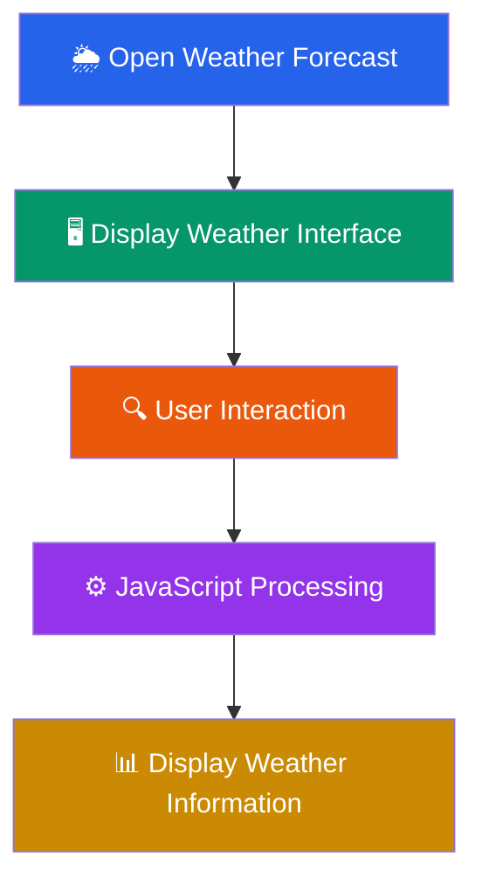

# <div align="center">🌦️ WEATHER FORECAST</div>

<div align="center">

### ☀️ Check the Weather • Plan Your Day • Stay Prepared


</div>

---

<div align="center">

**Weather Forecast** is a simple and interactive web application designed to provide weather information through an easy-to-use interface. The application allows users to check weather conditions and view weather-related information using a visually appealing design.

</div>

---

## 📌 Project Overview

Weather Forecast is a web-based application developed using HTML, CSS, and JavaScript. The application is designed to provide users with weather-related information through a simple and interactive interface.

The project consists of three primary files: `index.html`, `style.css`, and `script.js`. HTML is used to structure the webpage, CSS is used to style the application and create visual effects, and JavaScript is used to implement the interactive functionality.

The application provides a foundation for displaying weather information in a user-friendly format. It can be further enhanced by integrating weather APIs to retrieve real-time weather conditions for different locations.

---

## 🎯 Project Objectives

- Develop a simple and interactive weather forecast website.
- Provide an easy-to-use interface for accessing weather information.
- Create a visually appealing user interface using CSS.
- Implement user interactions using JavaScript.
- Organize the application into separate HTML, CSS, and JavaScript files.
- Display weather-related information in an organized format.
- Develop a foundation for integrating real-time weather APIs.
- Demonstrate practical frontend web development skills.

---

## ✨ Features

<table>
<tr>
<td width="50%">

### 🌤️ Weather Information

Provides a user interface for displaying weather-related information.

</td>
<td width="50%">

### 🔍 Weather Search

Designed for users to interact with the application and search weather information, depending on the implemented functionality.

</td>
</tr>

<tr>
<td width="50%">

### 🎨 User Interface

A simple and visually appealing weather application interface.

</td>
<td width="50%">

### ⚡ Interactive Functionality

JavaScript is used to handle user interactions and weather-related functionality.

</td>
</tr>

<tr>
<td width="50%">

### 📱 Simple Layout

Organized layout for presenting weather information clearly.

</td>
<td width="50%">

### 🌈 Styling and Effects

CSS styling for layout, colors, interface elements, and visual presentation.

</td>
</tr>
</table>

---

## 🛠️ Technologies Used

<div align="center">

| Technology | Purpose |
|---|---|
|  | Webpage structure and content |
|  | Styling, layout and visual effects |
|  | Interactive functionality |
|  | Development environment |
|  | Application execution |

</div>

---

## 🏗️ System Architecture

The Weather Forecast application follows a simple frontend architecture. The HTML file provides the structure of the webpage, the CSS file controls the appearance and layout, and the JavaScript file handles application logic and user interactions.



---

## 📂 Project Structure

```text
weather/
│
├── index.html
├── script.js
├── style.css
└── README.md
```

### File Description

| File | Description |
|---|---|
| `index.html` | Defines the structure and content of the Weather Forecast webpage |
| `script.js` | Contains the JavaScript logic and interactive functionality |
| `style.css` | Provides styling, layout, colors and visual effects |
| `README.md` | Documentation of the project |

---

## 📄 Project Components

### 1. HTML – Webpage Structure

The `index.html` file defines the structure of the Weather Forecast application.

HTML provides the foundation for the webpage by organizing the elements required to display the weather interface.

It is responsible for creating the webpage content and providing the structure for the interface elements.

The HTML page works together with CSS and JavaScript to create the complete application.

### 2. CSS – Styling and Visual Effects

The `style.css` file is responsible for the visual presentation of the Weather Forecast application.

CSS is used to improve the appearance of the webpage by defining colors, layouts, spacing, typography, and interface styling.

It helps create a visually organized weather interface and provides a consistent appearance across the application.

Depending on the implementation, CSS can also provide hover effects, transitions, responsive layouts, and other visual enhancements.

### 3. JavaScript – Interactive Functionality

The `script.js` file contains the JavaScript functionality of the application.

JavaScript allows the webpage to respond to user interactions and update the interface dynamically.

It is responsible for implementing the application's interaction logic and weather-related functionality according to the code.

If connected to a weather API, JavaScript can also retrieve weather information from an external service and display the returned data.

---

## 🔄 Application Workflow

The application follows a simple workflow where the user interacts with the webpage and the JavaScript logic processes the interaction.



### Workflow Explanation

**Step 1 – Open Application:** The user opens the Weather Forecast website in a browser.

**Step 2 – Display Interface:** The webpage displays the weather application interface.

**Step 3 – User Interaction:** The user interacts with the available interface elements.

**Step 4 – JavaScript Processing:** JavaScript processes the user interaction and performs the implemented functionality.

**Step 5 – Weather Information:** The application displays the resulting weather information according to its implementation.

---

## 📊 Weather Application Data Flow

The following diagram illustrates the conceptual data flow of a weather application.


<sub>This diagram represents a conceptual weather application flow. If the project uses a weather API, the data retrieval stage can be implemented through an API request.</sub>

---

## 🌡️ Weather Information

A weather forecast application can display various types of weather-related information depending on its implementation.

| Weather Information | Description |
|---|---|
| Location | Name of the city or location |
| Temperature | Temperature of the selected location |
| Weather Condition | Sunny, cloudy, rainy, etc. |
| Humidity | Moisture level in the air |
| Wind Speed | Speed of wind |
| Weather Icon | Visual representation of the weather |
| Forecast | Weather information for future periods, if available |

<sub>The fields above describe common weather application features; actual displayed fields depend on the project implementation.</sub>

---

## 🎨 User Interface Design

The Weather Forecast application focuses on simplicity and ease of use.

The user interface is designed to present weather information in a readable and organized format.

### Design Elements

- Simple webpage layout.
- Weather-related interface.
- Styled input elements.
- Weather information display area.
- Organized content.
- CSS-based visual presentation.

### User Experience Goals

- Easy navigation.
- Simple interaction.
- Readable weather information.
- Clean interface.
- Responsive design potential.
- Convenient weather information access.

---

## 🚀 How to Run the Project

### Prerequisites

Before running the application, ensure that the following are available:

- Visual Studio Code.
- Google Chrome or Microsoft Edge.
- Project files.
- Live Server extension (recommended).

### Method 1: Run Using Visual Studio Code

1. Download or extract the Weather Forecast project.
2. Open Visual Studio Code.
3. Click **File → Open Folder**.
4. Select the `weather` project folder.
5. Install the Live Server extension if necessary.
6. Open `index.html`.
7. Right-click the file.
8. Select **Open with Live Server**.

The application will open in the browser.

### Method 2: Run Directly in Browser

1. Open the project folder.
2. Locate `index.html`.
3. Double-click the file.
4. The application will open in your default browser.

---

## 🧪 Testing

The application can be tested manually by interacting with the interface and verifying that the webpage functions correctly.

| Test Case | Expected Result |
|---|---|
| Open application | Weather page loads |
| View interface | Weather interface is displayed |
| Interact with input | Input accepts user interaction |
| Execute weather functionality | JavaScript functionality executes |
| View weather information | Weather data is displayed according to implementation |
| Test buttons | Buttons respond according to implementation |
| Refresh webpage | Application reloads correctly |
| Browser compatibility | Application works in supported browsers |

---

## 💡 Advantages

- Simple and user-friendly interface.
- Easy to run in a web browser.
- Lightweight frontend application.
- Organized project structure.
- Demonstrates HTML, CSS, and JavaScript.
- Easy to maintain and modify.
- Can be enhanced with weather APIs.
- Suitable for beginner web development portfolios.

---

## ⚠️ Limitations

Depending on the implementation of the current project, the following limitations may apply:

- Limited weather information.
- No permanent database storage.
- Weather information may not be available without an API integration.
- Forecast data may not be dynamically updated.
- Limited location-based functionality.
- No advanced weather analytics.

---

## 🔮 Future Enhancements

The Weather Forecast application can be enhanced with additional features to improve functionality and usability.

### Real-Time Weather API Integration

Integrate a weather API to retrieve current weather information for different cities.

### Location-Based Weather

Use geolocation functionality to display weather information for the user's current location, with permission.

### Five-Day Forecast

Display weather forecasts for upcoming days.

### Hourly Forecast

Provide hourly weather information for the selected location.

### Weather Icons

Display weather icons based on the weather condition.

### Responsive Design

Improve compatibility with mobile devices, tablets, and desktops.

### Temperature Unit Conversion

Allow users to switch between Celsius and Fahrenheit.

### Weather Alerts

Display alerts for severe weather conditions where supported by the API.

### Search History

Maintain a list of recently searched locations.

### Enhanced UI

Add animations, transitions, backgrounds, and improved visual effects based on weather conditions.

---

## 📚 Learning Outcomes

This project provides practical experience in frontend web development.

Through the development of Weather Forecast, the following concepts can be explored:

- HTML webpage structure.
- CSS styling and layout.
- JavaScript functionality.
- User interaction handling.
- Frontend application design.
- Webpage organization.
- Browser-based execution.
- Testing web applications.
- API integration concepts.
- Project documentation.

---

## 📌 Conclusion

Weather Forecast is a simple web-based application developed using HTML, CSS, and JavaScript to provide an interactive weather-related interface.

The project demonstrates how frontend technologies can be combined to create a lightweight and user-friendly web application. HTML is used to structure the webpage, CSS is used to improve its appearance, and JavaScript is used to implement interactive functionality.

The project can be further enhanced through real-time weather API integration, location-based weather information, forecast displays, weather alerts, and responsive design improvements.

Weather Forecast provides a foundation for learning frontend web development and building more advanced weather applications.

---

<div align="center">

# 🌦️ WEATHER FORECAST

### Check the Weather • Stay Prepared • Plan Better

<sub>Built with HTML, CSS and JavaScript</sub>

</div>
